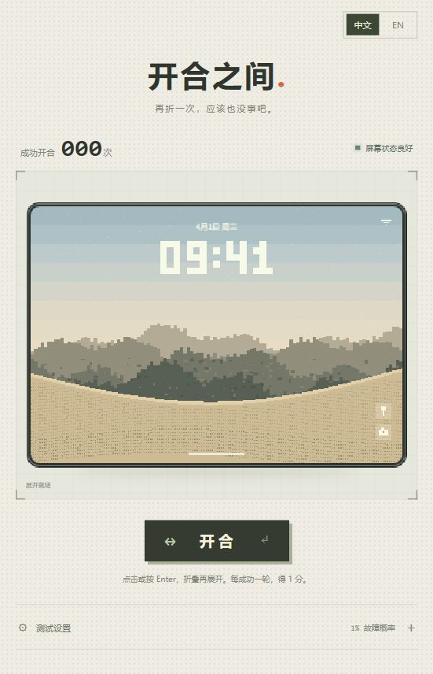
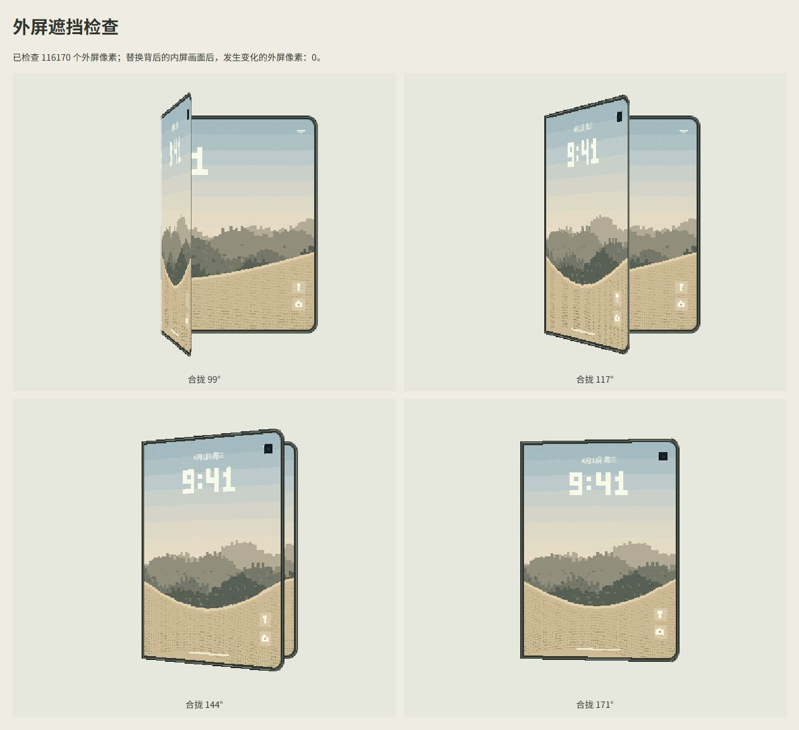
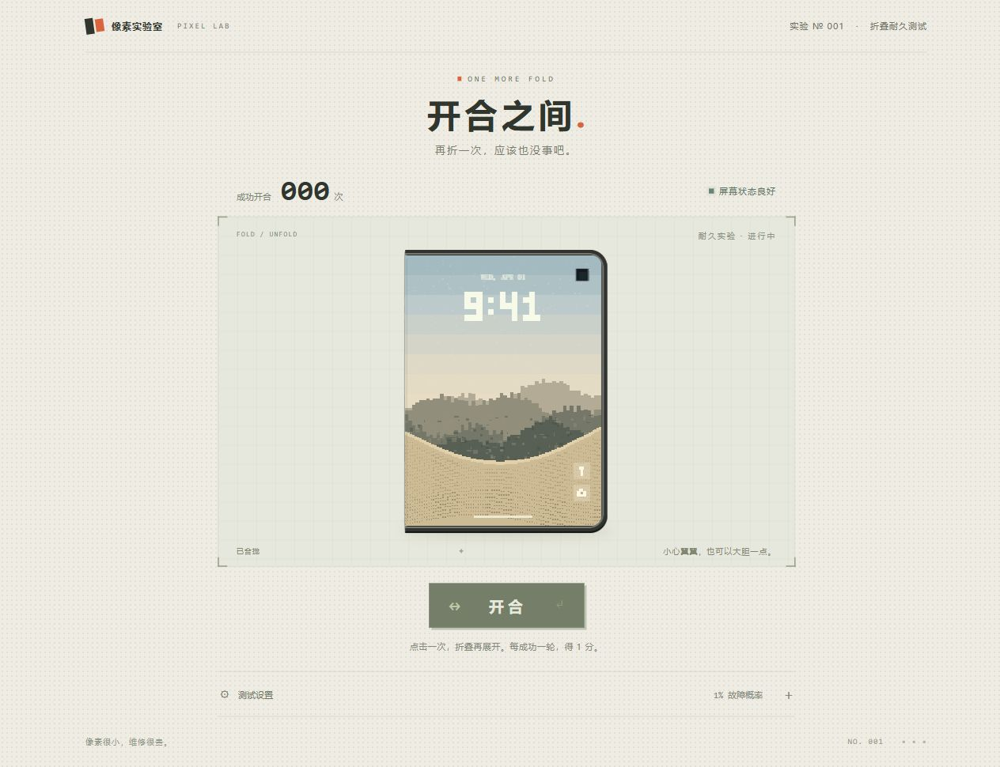
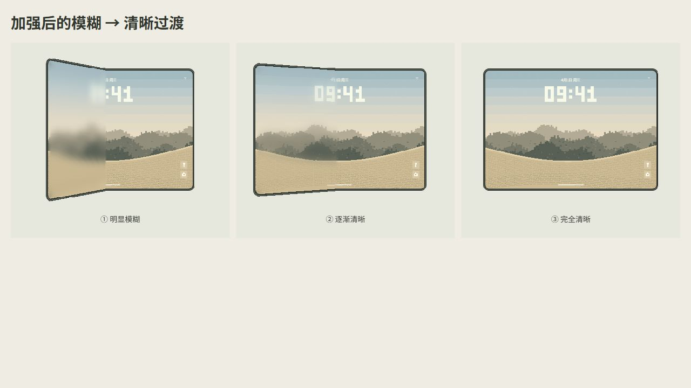
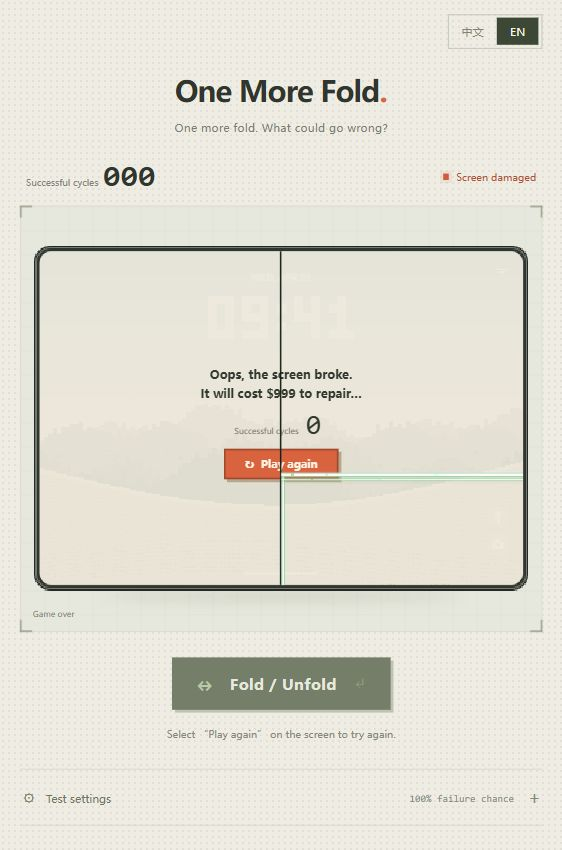

# 开合之间 · One More Fold

像素风折叠屏耐久小游戏。

## 基本玩法

- 点击「开合」或按 **Enter**，完成一次折叠和展开。
- 开合成功得 **1 分**，展开后判定故障，默认概率 **1%**。
- 点击「放在桌子上」，成功放下得 **2 分**。放桌故障概率默认 **2%**，最低 **2%**。
- 点击「跌落」，屏幕未损坏得 **20 分**。跌落故障概率默认且最低 **20%**。
- 手机在桌面或地面上时不能进行其他动作；点击「拿起来」恢复三种玩法，拿起不计分、不判定故障。
- 屏幕损坏后游戏结束，显示最终分数，点击「重玩」重新开始。
- 「测试设置」可分别调整开合、放桌与跌落故障概率，下一局生效；右上角可切换中文和英文。
- 右上角支持深色、浅色、跟随系统三种主题，默认跟随系统；内外屏壁纸与文字同步切换，手动选择会保存在浏览器中。
- 内外屏日期与时间跟随设备本地系统时间，采用24小时制；故障时冻结，重新开始后恢复同步。
- 检测到折叠屏特征后显示真机开合提示和设置，可通过**半折→展开**触发一轮，需要 **HTTPS**。

## 游戏截图

### 1. 展开就绪



### 2. 折叠过程



### 3. 完全合拢



### 4. 展开与清晰度过渡



### 5. 故障结算与重玩



## 本地部署

在项目根目录运行，需要 Python 3：

```powershell
python serve.py
```

默认监听 **`0.0.0.0:8000`**，本机访问 [http://127.0.0.1:8000](http://127.0.0.1:8000)。端口占用时会顺延。

| 参数 | 用途 | 默认值 |
| --- | --- | --- |
| `--host` | 监听地址 | `0.0.0.0` |
| `--port` | 起始端口 | `8000` |

修改监听地址和端口：

```powershell
python serve.py --host 127.0.0.1 --port 8080
```

也可使用 `npm start`，按 **Ctrl+C** 停止服务。

### HTTPS

使用受设备信任的证书：

```powershell
python serve.py --host 0.0.0.0 --port 8443 --certfile certs/server.pem --keyfile certs/server-key.pem
```

## 测试

```powershell
node --test tests/*.test.mjs
python -m unittest discover -s tests -p "test_*.py"
```

## 授权

[MIT License](LICENSE) · Copyright (c) 2026 DreamistW
